# Chatloop — Assignment 6 Chat App

A modern real-time chat app built with **Flutter** and **Firebase** (Auth, Cloud Firestore, Cloud Messaging), running entirely on the free **Spark** plan.

## Screenshots

| Login | Chats · Sunset | Chats · Sky | Chats · Neon |
|:---:|:---:|:---:|:---:|
| 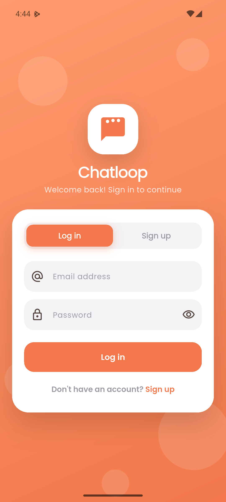 | 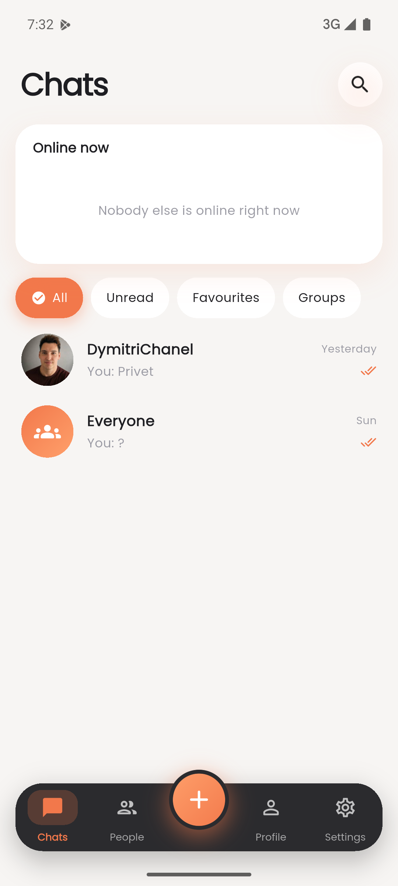 | 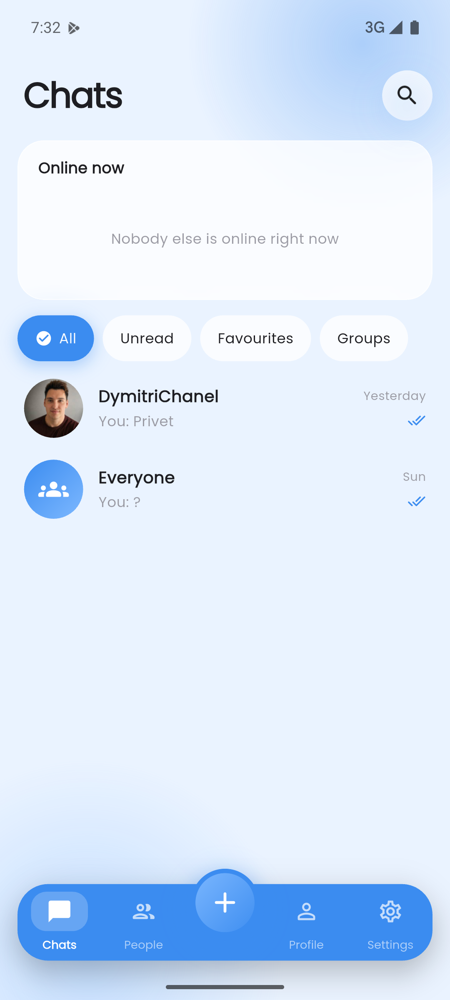 | 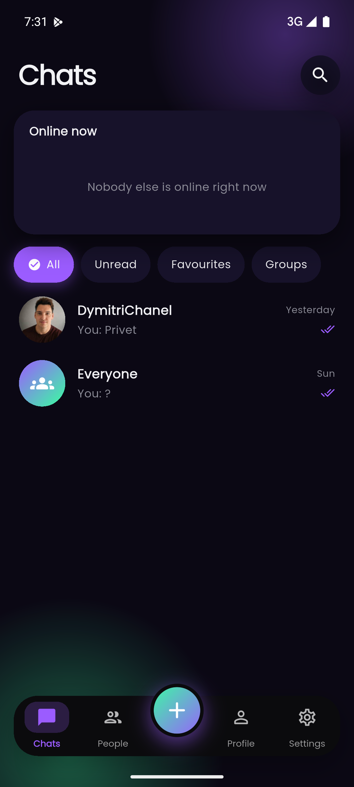 |

| Message actions | New chat | People | Profile · Mint |
|:---:|:---:|:---:|:---:|
| 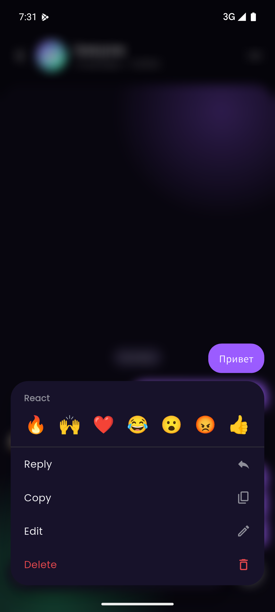 | 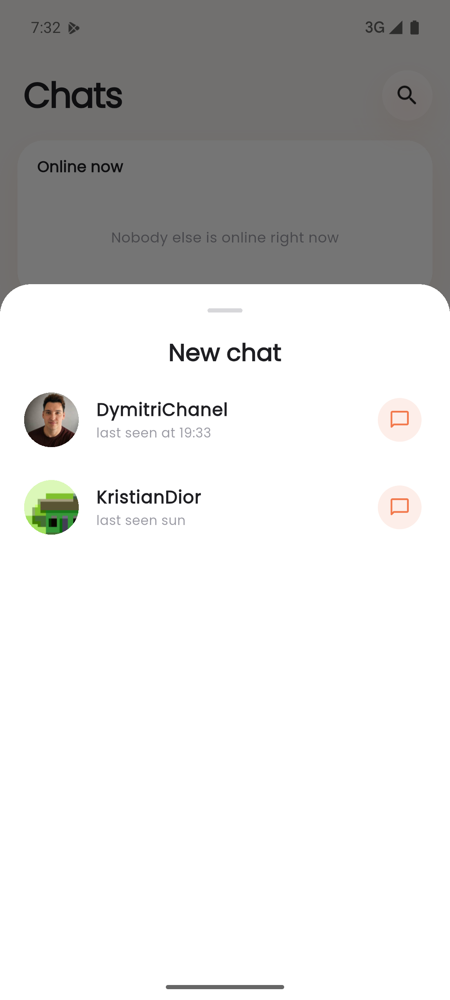 | 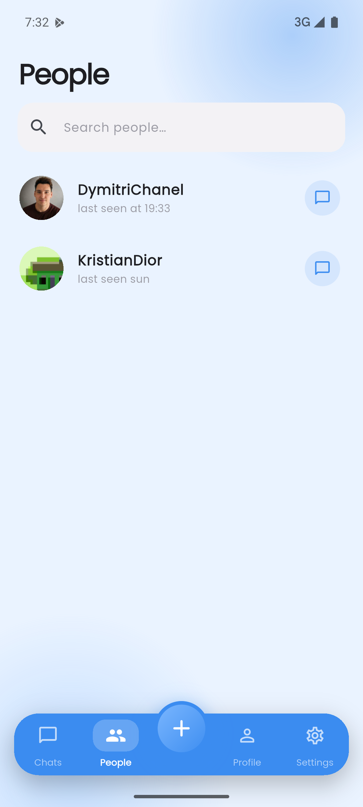 | 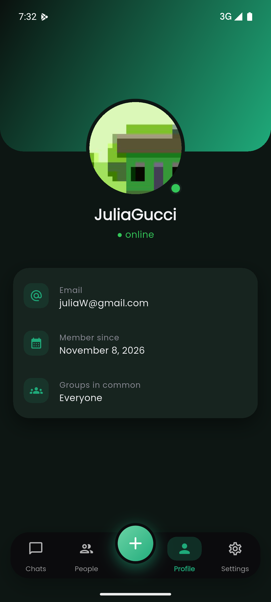 |

| Settings · Neon | Settings · Sky | Chats · Mint |
|:---:|:---:|:---:|
| 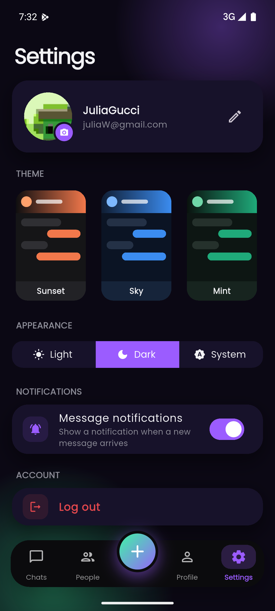 | 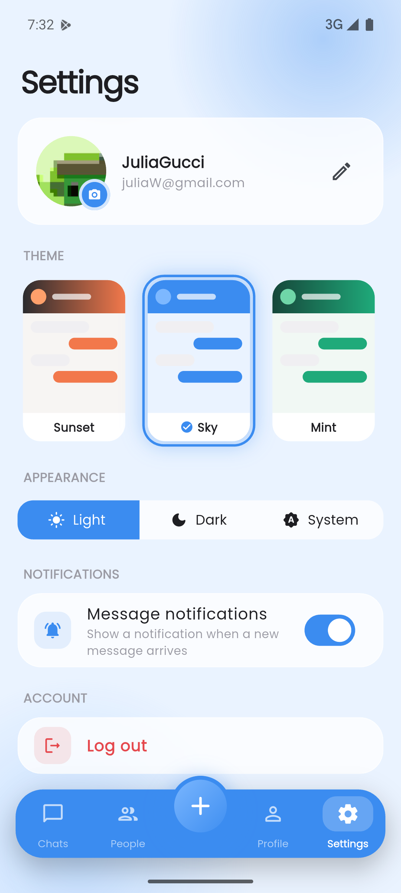 | 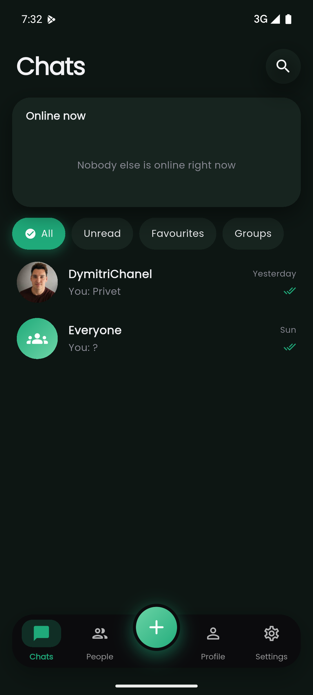 |

## Features

| Requirement | Implementation |
|---|---|
| 1. Registration with profile image | Sign-up form with camera/gallery picker, validation; image compressed to ≤320 px JPEG and stored in Firestore `avatars/{uid}` |
| 2. Login | Email + password, animated Login ⇄ Sign-up switch |
| 3. Authentication & errors | `AuthGate` listens to `authStateChanges()`; Firebase error codes mapped to friendly messages (wrong password, email in use, no network …) |
| 4. Chat interface | Bubbles with sender name, profile picture, time, day separators, read ticks |
| 5. Send messages | Composer with emoji row, reply and edit modes |
| 6. Receive messages | Firestore real-time streams — UI updates instantly |
| 7. Push notifications | FCM (token stored per user, foreground/background/tap handling) + local notifications for new messages while the app is in the background |
| 8. Firebase integration | Auth, Firestore (users, avatars, chats, messages), Messaging, security rules |
| 9. Logout | Confirm dialog → token removed, status offline → back to login |

Extras inspired by the design references:

- Chat list with **Online now** row, search, filters (All / Unread / Favourites / Groups), **pinned** chats, unread badges
- 1-to-1 chats + shared group chat **Everyone** (all users join automatically)
- Message actions sheet: **reactions** 🔥🙌❤️😂😮😡👍, reply (also swipe-right), copy, edit, delete
- Typing indicator, online / last-seen presence
- User profiles, people directory, editable username / bio / avatar
- **4 themes** — Sunset (default), Sky (glass), Mint, Neon — each with **Light / Dark / System** mode
- Poppins font, soft shadows, Hero transitions and `flutter_animate` animations

## Project structure

```
lib/
  main.dart                 Firebase init, theming, AuthGate
  firebase_options.dart     generated by `flutterfire configure` (git-ignored)
  models/                   AppUser, Chat, Message
  services/                 auth, user, chat, notification services
  providers/                Riverpod providers (streams)
  theme/                    palettes, ThemeData builder, theme settings
  screens/                  auth, home shell, chats, chat, people, profile, settings
  widgets/                  avatar, message bubble, common UI
firestore.rules             security rules
functions/                  optional Cloud Function for server push (Blaze plan)
```

## Setup

Requirements: Flutter 3.47+, Node.js, Firebase CLI (`npm i -g firebase-tools`) and FlutterFire CLI (`dart pub global activate flutterfire_cli`).
On Windows enable **Developer Mode** (`start ms-settings:developers`) — Flutter needs symlinks to build plugins.

1. Log in and create a Firebase project:

   ```bash
   firebase login
   ```

   ```bash
   firebase projects:create chatloop-<your-name> --display-name "Chatloop"
   ```

2. In the [Firebase console](https://console.firebase.google.com):
   - **Authentication → Sign-in method → Email/Password → Enable**
   - **Firestore Database → Create database** (any location, production mode)

3. Connect the app (generates `lib/firebase_options.dart` and `google-services.json`):

   ```bash
   flutterfire configure --project=chatloop-<your-name> --platforms=android,ios
   ```

4. Deploy the security rules:

   ```bash
   firebase deploy --only firestore:rules --project chatloop-<your-name>
   ```

5. Run:

   ```bash
   flutter run
   ```

### Push notifications

- **FCM:** open *Messaging → Create campaign / Send test message* in the Firebase console and paste a device token (stored in `users/{uid}.fcmToken`) or target the topic `chat`.
- **New messages (free plan):** while the app is in the background, incoming messages raise a local notification with sender name, avatar and text. Tapping it opens the chat.
- **Server push (optional, Blaze plan):** `functions/index.js` sends an FCM push to all other chat members for every new message, even when the app is closed:

  ```bash
  cd functions && npm install && cd .. && firebase deploy --only functions
  ```

  Then set `kServerPushEnabled = true` in `lib/services/notification_service.dart`.

## Build an APK

```bash
flutter build apk --release
```

The file is written to `build/app/outputs/flutter-apk/app-release.apk` and can be installed on any Android 6.0+ phone (or via USB with `flutter install`).

## API keys

`lib/firebase_options.dart`, `android/app/google-services.json` and `ios/Runner/GoogleService-Info.plist` contain the project's API keys and are listed in `.gitignore`. Run `flutterfire configure` to regenerate them locally.

## Tests

```bash
flutter analyze
```

```bash
flutter test
```
